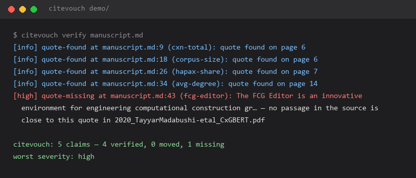
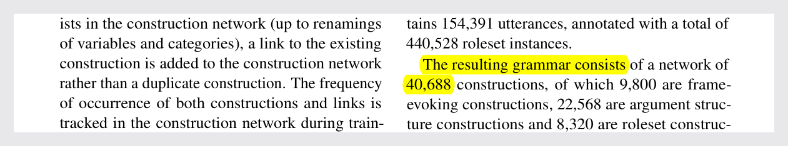

# citevouch

[English](README.md) · **简体中文**

**把稿件里的每一条论断钉在证明它的那份 PDF 的那一页上——证据一漂移，CI 立刻红。**

`citevouch` 不是又一个「这个 DOI 存在吗」的检查器。那样的工具已经有了，而且不少，它们回答的是另一个问题。它回答的是你交稿前夜真正面对的那个问题：

> 这一段写着 154,391 句。这个数字真的在它引用的那篇论文第 6 页上吗？还是我从论文的旧草稿里抄的——甚至从另一篇论文里抄的？



你在每一句想要被核对的话旁边写一个 claim 块。块里写清楚：本地 PDF、页码、逐字原文。`citevouch scan` 把这些证据记录进一个可以提交的账本（lockfile）；`citevouch verify` 重新打开 PDF，告诉你哪些证据依然成立、哪些挪了位置、哪些已经消失。

```text
$ cd demo && citevouch verify manuscript.md
[info] quote-found at manuscript.md:9 (cxn-total): quote found on page 6
[info] quote-found at manuscript.md:18 (corpus-size): quote found on page 6
[info] quote-found at manuscript.md:26 (hapax-share): quote found on page 7
[info] quote-found at manuscript.md:34 (avg-degree): quote found on page 14
[high] quote-missing at manuscript.md:43 (fcg-editor): The FCG Editor is an innovative environment for
  engineering computational construction gr… — no passage in the source is close to this quote in
  2020_TayyarMadabushi-etal_CxGBERT.pdf

citevouch: 5 claims — 4 verified, 0 moved, 1 missing
worst severity: high
```

这不是示意图——上面就是本仓库 `demo/` 跑出来的真实输出：第五条断言引的那句话出自另一篇论文，而这正是这个工具存在的理由。下面是被引的那一页，黄色高亮的那句就是 `quote-found on page 6` 说的东西：



两张图都由 `tools/make_figures.py` 从 demo 生成；如果图里烧进去的文字和 demo 现在的输出对不上，`tests/test_figures.py` 会失败。

## 这是给你的吗？

**合适用**：你手上有一批 PDF（或导出的文本），稿件里大量「这句话有出处、这个数来自那篇论文」式断言；你要在提交、交稿、发版之前让机器把它们全部核一遍，之后每次改稿都自动再核。文献综述、系统综述、教科书讲义、事实核查型长文、被 AI 润色过而你不放心数字的稿子——都是标准场景。

**不用它**：如果你要查的是「引用的论文本身是否真实存在、有没有被撤稿」，去用 citegate 一类对 Crossref/OpenAlex 的 DOI 检查器，两者互补（见下表）。如果文献全在网上、本地没有一份确定的 PDF 或文本，它没有东西可以核对——它刻意不联网，全部发生在你机器上的文件之间。

一句话：**DOI 检查器管「论文是不是真的」，citevouch 管「你对论文的陈述是不是还对得上原文」。** 论文是真的、DOI 没错、年份没错，但 40,688 被抄成 40,668——前者永远查不出来，后者就是这个工具存在的原因。

## 它和别的工具差在哪

| | 查什么 | 抓得住 | 抓不住 |
|---|---|---|---|
| DOI / 元数据检查器 | 引文在 Crossref / OpenAlex 能解析 | 幻觉引用、撤稿、年份错 | 真论文被引错内容 |
| 文献管理软件 | 格式、重复条目 | — | 一切语义问题 |
| **citevouch** | **这句话 ↔ 那个文件的哪一页** | 抄错的数字、漂成转述的「引文」、被换成新版/另一版的 PDF、只存在于想象中的引文 | 论文本身好不好 |

两者互补。幻觉出来的引用没有本地 PDF，能骗过这里的一切检查；真实引用配一个抄错的数字，能骗过一切 DOI 检查。两个都跑。

## 「漂移」指什么

一月核对通过的论断，到三月未必还成立。`citevouch` 区分证据变坏的每一种方式：

| 代码 | 严重度 | 含义 |
|---|---|---|
| `quote-found` | info | 引文还在所记页面上 |
| `quote-moved` | medium | 引文在文档里，但换了页（排版变了） |
| `quote-fuzzy` | high | 只有近似匹配——**绝不算通过** |
| `quote-missing` | high | 全文找不到与引文接近的段落 |
| `number-absent-in-quote` | high | 引文里的数字不在所引页面上 |
| `source-changed` | medium | PDF 与账本记录的那份字节不同 |
| `source-missing` | high | 账本要的那份 PDF 找不到了 |
| `source-unreadable` | high | PDF 在，但抽不出文本 |
| `page-out-of-range` | high | 页码不是该文档的真实页（小于 1 或超出总页数） |
| `ledger-stale` | high | 稿件自账本记录后被改过 |
| `bib-key-missing` | high | claim 引用的书目键不存在 |
| `bib-key-unused` | info | 有条目没有任何 claim 引用（聚合成一行） |
| `bib-duplicate-key` | high | 两个条目共用一个键 |
| `bib-unparsed-entry` | high | 有条目定界符始终未闭合，它之后的条目全部读不到 |
| `bib-entry-header-unparsed` | medium | 条目之间残留了读不到的文本，或 `@` 头不是可用条目 |
| `bib-field-malformed` | medium | 某字段无法读取；该条目的其余字段仍会继续解析 |
| `bib-field-duplicate` | medium | 同一条目里同一字段出现两次（字段名不分大小写）；保留首个值 |
| `bib-macro-unknown` | medium | 字段引用了尚未定义的 `@string` 宏；宏名按字面保留 |
| `bib-field-empty` | medium | 必填字段为空或缺失 |
| `claim-without-evidence` | low | 【原文】/【推测】式标记没有配 claim 块 |
| `claim-block-unclosed` | high | 某个 `` ```claim `` 块始终没有闭合，它之后的每条 claim 都被读成了它的一部分 |
| `claim-uncheckable` | high | 某条 claim 块根本无法核对——缺 `source=`、缺引文、缺 id，或 id 重复导致第二块被丢弃 |
| `page-unreadable` | medium | `page=` 提示不是数字，会被忽略，引文改为按搜索定位 |

退出码就是 CI 契约：没有任何发现达到 `--fail-on`（默认 `high`）时返回 `0`，达到时返回 `1`，用法错误返回 `2`。CI 里不需要任何包装逻辑。

## 安装

尚未发布到 PyPI——发布工作流会在本仓库注册 trusted publisher 之后向 PyPI 发布，并如实报告结果。在那之前，从 GitHub 安装：

```bash
pip install "git+https://github.com/lyear12/citevouch@v0.16.3"
# 或者，克隆之后本地安装：
pip install .
```

需要 Python 3.10+。

PDF 抽取用 [pypdf](https://pypi.org/project/pypdf/)；`PATH` 上有 `pdftotext`（poppler）时作为第二引擎；纯文本源零依赖即可核对。

## 60 秒上手

```bash
citevouch init-demo my-paper      # 生成一个当场就能通过的项目
cd my-paper
citevouch verify manuscript.md    # "1 claim — 1 verified"
```

`init-demo` 不只写文件，还会记录账本，所以它交给你的项目本来就处在 `verify` 能读的状态。把演示源换成真实 PDF 后，用 `citevouch scan` 记录新证据；之后每次改稿跑 `verify`——CI 里跑的也是它。

手工的话，一共三个文件：

**`manuscript.md`** —— claim 块紧贴它支撑的那句话。

````markdown
```claim id=corpus-size source=vaneecke2026cxn ref=vaneecke2026learning page=6
quote: |
  Together, the combined corpus contains 154,391 utterances, annotated with a total of 440,528
  roleset instances.
claim: |
  训练语料合计 154,391 句 / 440,528 个角色集实例。
```
````

**`sources.toml`** —— 把你用的名字映射到文件。

```toml
[sources]
vaneecke2026cxn = "papers/2026_VanEecke-Beuls_CoNLL2026_large-scale-CxG.pdf"
```

**`refs.bib`** —— 可选。提供时，claim 的书目键会对着它核查。

```bash
citevouch scan   manuscript.md --root . --bib refs.bib    # 写出 citevouch.lock.json
citevouch verify manuscript.md --root .                   # 重读 PDF 核对
citevouch check  manuscript.md --root . --format markdown # 直接贴进 PR 的报告
```

把 `citevouch.lock.json` 提交进仓库。它是让「漂移」可被检出的记忆：没有它，`verify` 只能说「找到了」，永远说不出「挪了位置」。

仓库里的 [demo/](demo/) 是一个完整的真实项目：5 条断言取自两篇真实论文，两篇都被真正引用（含一条故意引用了一篇**根本没有那句话**的论文，工具必须对它说不，见 [demo/manuscript.md](demo/manuscript.md)），账本、页码、两份 PDF 的 SHA-256 全对得上——换掉任意一份，`verify` 都会报 `source-changed`。

### 当它说「每条引文都找不到」

先跑 `citevouch doctor`，再决定要不要相信它。

```text
$ citevouch doctor --root demo
[ok  ] python      3.12
[ok  ] pypdf       6.16.1 (reads PDFs in-process)
[ok  ] pdftotext   not on PATH (not needed; pypdf is installed)
[ok  ] cache       demo/.citevouch/cache is writable
[ok  ] manuscript  demo/manuscript.md (2154 bytes)
[ok  ] manifest    demo/sources.toml (148 bytes)

Everything this tool needs is on this machine. If quotes are still reported missing, the source files are the place to look.
```

（这是在「用 pip 装了 `pypdf`、没装 poppler」的机器上跑的；装了 `pdftotext` 时第三行会打印它的路径，
中间做省略。Windows 打印的是反斜杠。）

真正把人赶走这个工具的，不是报错。是一次跑完、每条引文都报「找不到」，因为 PDF 根本没被读出来，
而那段输出里没有一个字说明这一点——于是合理的反应是卸载。`doctor` 是唯一允许让人安心的命令：
它查抽取器在不在、缓存能不能写、解释器够不够新、项目点名的文件到底在不在。有问题时它退 `1`，
而这是全工具唯一一处 `1` 表示「你的机器有问题」而不是「你的稿子有问题」。

### 从稿件开始，而不是从一个空文件开始

手工写前二十条 claim 块，就是这个工具把人劝退的地方。`draft` 读你的稿件，找出每一处引用，
在稿件旁边写一份提案文件：

```bash
citevouch draft manuscript.md --root . -o claims.md
```

```text
citevouch: 1 claim block(s) proposed (0 verbatim), 2 citation(s) left as comments
```

每一条提案都是那条引用解析到的那份文件里、最相关的那一页上的一句真实原文，带上它的页码，
所以 `scan` 和 `verify` 立刻就能收下它：

```markdown
<!-- confidence: medium - the best sentence on the most relevant page (4 shared terms); read it before trusting the claim -->
```claim id=vaneecke2026cxn source=vaneecke2026cxn page=5
quote: |
  When more links are later added to the grammar network as more training examples are processed,
  the same tell.01 construction can be reused in combination with other frame-evoking or argument
  structure constructions to process utterances such as “Ah, why should you come out if you were
  told not to?
claim: |
  Construction grammar treats a grammar as a network of constructions, and this network is learned
  from data rather than written by hand.
```
```

有三件事它不做，而且会写在文件里而不是偷偷做：不改你的稿件，不提出它没从那一页读到的句子，
不发明引用。找不到本地文件的 key 会变成一行注释，说明该补什么；某条引用的最佳段落已经被前面
一条引用用掉时，也是一行注释，而不是把同一段引文写两遍。`high` 置信度表示你自己那句话在原文里
逐字存在——这种情况不需要判断；`medium` 表示右侧页面上的真实句子，但你仍然得读一遍。

书目里已经知道对应文件的 key，传 `--bib refs.bib`。key 不在 `sources.toml` 里时，Zotero 的
`file` 字段会被用上，并且文件里会把该粘进 `[sources]` 的那一行写出来。

### 若你的稿件是 LaTeX

直接传 `.tex` 文件。它会在被读之前先转换，所以命令还是同一条：

```bash
citevouch draft paper.tex --bib refs.bib -o claims.md
```

`\citep{a, b}`、`\citet`、`\textcite` 等引用命令会变成 Markdown 路径用的同一种标记，`%` 注释
与 `thebibliography` 被丢弃，章节标题单独成段，免得和下面那句粘在一起。`[p.~3]` 这类页码注解
也会被丢掉——页码永远来自 PDF，绝不来自你的源码。

这是转换器，不是 TeX 解析器：会生成文本的宏、`\input`、以及正文并非散文的环境，要么被当散文
读，要么被跳过。代价是提案可能更弱，绝不会是假通过——`claim` 块里的引文永远从 PDF 里读出来，
所以一句被弄乱的稿子不可能让引用看起来已核实。`scan` 和 `verify` 从不看 LaTeX，只有这条命令看。

### 三种 claim 方言

围栏块（上面那种）、HTML 注释、表格行。挑一种在你的编辑器里活得下来的：

```markdown
<!-- claim: c2 source=smith2026cxn page=4 -->
>> The corpus contains 154,391 utterances.

| id | source | page | quote | claim |
|----|--------|------|-------|-------|
| c3 | smith2026cxn | 7 | almost half (48.4%) occur only once | 48.4% 是 hapax |
```

如果你的稿件里要保留一段语法示例（教程章、自己的 README），请用**四个**反引号（`` ```` ``）围起来，
不要用三个。三反引号里出现一行 ```claim，和「一个 claim 块忘了收尾」在文本上无法区分，工具不会去猜，
它会报 `claim-block-unclosed`（high）。四个反引号能明确表示「这是示例」。

### 挂进 CI

最短的接法是 action：它装上自己被钉住的那个 tag，然后跑闸门。

```yaml
- uses: lyear12/citevouch@v0.16.3
  with:
    manuscript: manuscript.md
```

它会写出 SARIF 文件，并把路径作为 `sarif` 输出交出来，所以再加一步就能传给 code scanning：

```yaml
- uses: lyear12/citevouch@v0.16.3
  id: citevouch
  with:
    manuscript: manuscript.md
    fail-on: high
- uses: github/codeql-action/upload-sarif@v3
  with:
    sarif_file: ${{ steps.citevouch.outputs.sarif }}
```

不想用 action 的话，三行等价：

```yaml
- uses: actions/setup-python@v5
  with: { python-version: "3.12" }
- run: pip install "git+https://github.com/lyear12/citevouch@v0.16.3"
- run: citevouch check manuscript.md --root . --use-recorded --format sarif > citevouch.sarif
```

`--use-recorded` 核对已提交的账本而不是重新解析稿件，所以这个岗位只在「PDF 或稿件在证据脚下动了」时变红——这正是 CI 闸门该盯的事。SARIF 传给 code scanning 后，发现会以行内标注出现在 PR 上。

## 设计取舍

- **引文是锚点，页码只是提示。** PDF 会被不同工具重排，文本还在、页码全变。按文本匹配能活过重排，按页码匹配不能。
- **近似匹配永远不算通过。** 转述不是引文。fuzzy 存在的意义是「那儿有一段像的，人去看一眼」，所以它被报成 `quote-fuzzy`（high）——和「引文根本不在」同一个严重度，同一个卡点，永远不可能被误当成一次通过。
- **稿件哈希最先检查。** 稿件只要动过，所有 claim 一律 `skipped`，只出一条 `ledger-stale`——一条诚实的失败好过三十条迷惑的。
- **常见类别只报一行。** 37 条未被引用的书目是一行摘要，一条消失的引文独占一行。会被划过去的发现等于没有发现。
- **没有网络。** 一切发生在本机文件之间。断网机房里的运行和 CI 里的运行行为完全一致。

## 状态

1.0 之前。版本策略见 [docs/maintenance.md](docs/maintenance.md)：补丁版只装修复，次版本装新能力；账本的 `schema` 字段（至今仍是 1，自首提交未变）是兼容性闸门。真变了格式，那一版会 bump 这个字段并在此说明，而 `verify` 会拒绝读不懂的账本，而不是猜。

本仓库自身就是这么维护的：AGENTS.md、LESSONS.md、docs/code-standards.md 写给编码代理，发版由 `auto-release.yml` 根据 CHANGELOG 自动决定并打出——它同时是本文档所有承诺的活证据。

## 许可

MIT。见 [LICENSE](LICENSE)。
